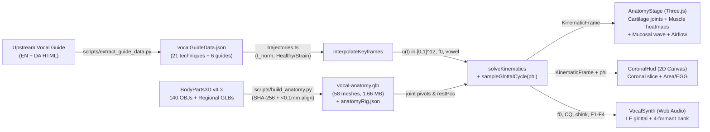

# Vocal Guide 3+1D (`vocal-guide-4d`)

**Live Interactive Studio:** [https://alok.github.io/vocal-guide-4d/](https://alok.github.io/vocal-guide-4d/)

An interactive **3+1D ($\mathbb{R}^3 \times \mathbb{R}_t$) biomechanical vocal atlas** that combines [Jesper Ordrup's Vocal Guide](https://jesperordrup.github.io/vocal-guide/) (21 singing techniques across 5 categories, Complete Vocal Technique [CVT] 4-mode cross-reference, 5-minute guided warm-up, 6-step beginner roadmap, anatomy notes, and 10 vocal myths, in English & Danish) with real-time **3D muscle kinematics, stroboscopic mucosal-wave simulation, and LF-formant Web Audio synthesis** built on verified **BodyParts3D v4.3** human anatomy.

---

## Why 3+1D?

Prose descriptions of singing ("thin the folds", "narrow the aryepiglottic twang funnel", "handoff from chest to head across passaggio", "hold rib expansion while abs meter exhalation") describe **time-varying 3D motor coordination** across hidden internal muscles. Static diagrams cannot show:

1. **Macro Exercise Choreography ($t \in [0, T]$)** — How silent inspiratory abduction (`PCA + DIA`) transitions into pre-phonatory set (`LCA + IA + APP`), glides across registers (`TA` body weight handing off to `CT` cricothyroid visor stretch), shapes resonance (`AES` twang collar + `VEL` soft-palate lift + tongue vowel tuning), and releases cleanly.
2. **Micro Stroboscopic Glottal Cycle ($\phi \in [0, 2\pi)$)** — How the inferior vocal-fold edge leads the superior edge by $\Delta\psi \approx 60^\circ$ (convergent opening $\to$ divergent closing), why **Falsetto** leaves a posterior triangular `IA` chink while **Head Voice** maintains full closure, why **Whistle Register** damps to a tiny anterior pocket, and how **Grit / Overdrive / Growl** recruit supraglottic ventricular (`FVF`) folds safely above un-slammed true vocal folds.
3. **Healthy vs. Strain A/B Mode** — Flip any technique between **Healthy Coordination** and **Vocal Strain Fault** to watch what happens when singers push pure `TA` chest weight upward, hike the larynx (`SUP`), jut the jaw forward, or collapse the ribcage (`clavicularHeave`).

---

## Architecture (Wiring Diagram)



---

## 12 Neuromotor Control Channels

Every preset trajectory (and the interactive **Manual Muscle Sandbox**) drives a 12-dimensional activation vector $\mathbf{u}(t) \in [0, 1]^{12}$:

| Channel | Layer | Anatomical Structures | Primary Vocal Action |
| :--- | :--- | :--- | :--- |
| `CT` | Larynx | Cricothyroid (*pars recta* & *pars obliqua*) | Tilts thyroid visor forward/down on cricoid, stretching & thinning vocal folds (`+26%`) to raise $f_0$ |
| `TA` | Larynx | Thyroarytenoid & Vocalis | Thickens, shortens, and stiffens fold body (`~5 mm`) for chest weight & high closed quotient (`CQ`) |
| `LCA` | Larynx | Lateral Cricoarytenoid | Rotates arytenoid vocal processes medially to approximate the membranous glottis |
| `IA` | Larynx | Transverse & Oblique Arytenoid | Slides arytenoids together to seal the posterior cartilaginous glottis (relaxed in falsetto/breathy) |
| `PCA` | Larynx | Posterior Cricoarytenoid | Sole abductor: swings vocal folds wide into a V-glottis for silent rapid inhalation |
| `AES` | Larynx | Aryepiglottic Sphincter & Epiglottis | Narrows epilaryngeal collar to create **Twang** and boost the `2.8–3.2 kHz` singer's formant ring |
| `FVF` | Larynx | Ventricular (False) Folds | Supraglottic cushions adding controlled subharmonic grit/growl—or constricting during vocal strain |
| `INF` | Extrinsic | Sternothyroid, Sternohyoid, Thyrohyoid, Omohyoid | Stabilizes or gently lowers the larynx (`Cry/Sob`, warm open throat) |
| `SUP` | Extrinsic | Digastric, Stylohyoid, Mylohyoid, Masseter | Elevates larynx / closes jaw; over-recruitment under high pressure drives vocal strain |
| `VEL` | Vocal Tract | Levator/Tensor Veli Palatini & Tongue | Lifts soft palate (sealing nasal port; relaxed in `"Mmm"` humming) & tunes vowel formants $F_1, F_2$ |
| `DIA` | Breath | Thoracic Diaphragm | Contracts downward (`~3.4 cm`) to expand lower lungs during `360°` inhalation |
| `APP` | Breath | External Intercostals, Obliques & Transversus | *Appoggio*: holds rib cage expanded while abdominal wall meters rock-steady subglottal pressure $P_{\text{sub}}$ |

---

## Quick Start

```bash
# Install frontend dependencies and start dev server
npm install
npm run dev

# Run biomechanical & anatomical unit tests (Vitest)
npm test

# Production typecheck + bundle
npm run build
```

### Rebuilding Anatomical Assets or Guide Data (Optional, `uv`-managed)

```bash
# Verify SHA-256 checksums & sub-0.1mm BodyParts3D v4.3 landmark alignment
uv run scripts/build_anatomy.py --verify

# Rebuild public/models/vocal-anatomy.glb + src/data/anatomyRig.json from upstream sources
uv run scripts/build_anatomy.py

# Re-extract bilingual EN/DA guide data from upstream Vocal Guide HTML
uv run scripts/extract_guide_data.py
```

See [`docs/DEV_GUIDE.md`](docs/DEV_GUIDE.md) for an exhaustive, first-principles developer guide covering the voice science, coordinate geometry, joint kinematics, mucosal-wave equations, and Three.js / Web Audio architecture.

---

## Credits & Licensing

- **Code & 3+1D Simulation Engine**: [MIT License](LICENSE) — Copyright © 2026 Alok Singh.
- **Vocal Technique Guide Content**: Adapted from [Vocal Guide](https://jesperordrup.github.io/vocal-guide/) ([`jesperordrup/vocal-guide`](https://github.com/jesperordrup/vocal-guide)) — Copyright © 2026 Jesper Ordrup ([MIT License](LICENSE)).
- **3D Anatomical Meshes (`public/models/vocal-anatomy.glb`)**: Derived from **BodyParts3D / Anatomography v4.3**, © The Database Center for Life Science (DBCLS), licensed under [CC BY-SA 2.1 Japan](https://creativecommons.org/licenses/by-sa/2.1/jp/deed.en). Full citation and SHA-256 provenance in [`public/models/ATTRIBUTION.md`](public/models/ATTRIBUTION.md).
