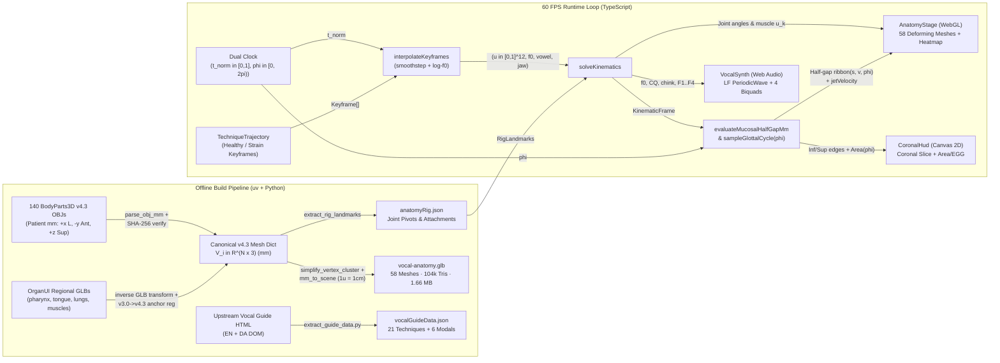

# Building `vocal-guide-4d` From Scratch — Exhaustive Developer & Biomechanics Guide

This guide teaches **every layer** of `vocal-guide-4d`—anatomical provenance, coordinate-frame algebra, laryngeal biomechanics, mucosal-wave fluid-structure physics, acoustic formant synthesis, and 60 FPS Three.js vertex deformation—in enough detail that you could sit down with an empty directory and code the entire system yourself.

---

## 1. System Context & Core Design Problem

### 1.1 Why Singing Pedagogy Needs $\mathbb{R}^3 \times \mathbb{R}_t$ (`3+1D`)

Traditional vocal pedagogy (and Jesper Ordrup's clear 21-technique reference) teaches through *sensory metaphors* ("sing into the mask", "hold the sob", "blend chest and head", "support from the diaphragm"). Sensory cues are useful once a singer already knows what coordination feels like, but they suffer from three structural ambiguities:

1. **Spatial occlusion**: The intrinsic laryngeal muscles (`CT`, `TA`, `LCA`, `IA`, `PCA`, `AES`) sit behind the thyroid shield inside a $\sim 4\,\text{cm}$ cylinder in the neck, coupled mechanically to extrinsic strap muscles above and below the hyoid bone, articulators above (`tongue`, `velum`, `mandible`), and a $\sim 35\,\text{cm}$ thoraco-abdominal pressure pump (`diaphragm`, `intercostals`, `obliques`, `transversus`) below.
2. **Temporal scale separation (`10^3` ratio!)**:
   - An **exercise gesture** (e.g., an inhale $\to$ onset $\to$ 1.5-octave mixed-voice siren $\to$ sustain $\to$ release) unfolds over **macro time** $t \in [0, 8\,\text{s}]$.
   - Meanwhile, the **vocal fold mucosa** oscillates at $f_0 \in [60, 1200]\,\text{Hz}$ (a $2\,\text{ms}$ period at $\text{C5} = 523\,\text{Hz}$!). At real speed, the human eye sees only a blur; clinically, laryngologists use **videostroboscopy** to alias the cycle down to $\sim 2\,\text{Hz}$ slow motion over **micro phase** $\phi \in [0, 2\pi)$.
3. **Failure-mode invisibility**: A singer trying to "belt" often increases `TA` + suprahyoid elevation (`SUP`) + jaw protrusion instead of pairing `TA` with `CT` stretch + `AES` epilaryngeal narrowing + `APP` rib support. Without seeing **Healthy vs. Strain A/B** side-by-side on the *same* 3D rig, prose warnings ("don't push!") remain abstract.

### 1.2 Category-Theoretic Wiring Diagram of the Architecture

Think of the application as a composition of pure, deterministic maps (morphisms) between typed state spaces, terminating in three synchronized rendering functors (`Three.js`, `Canvas2D`, `WebAudio`):

Notice the crucial architectural invariant: **`solveKinematics` and `sampleGlottalCycle` have zero Three.js, DOM, or Web Audio dependencies.** That is why `tests/biomechanics.test.ts` can verify all 21 techniques and physical invariants in **7 milliseconds** under Vitest, and why all three outputs (3D WebGL, 2D Coronal/EGG oscilloscope, and Web Audio formant synth) can never drift out of sync—they are projections of the exact same `KinematicFrame` value on every `requestAnimationFrame` tick!

---

## 2. Voice Science Background You Need Before Writing Code

### 2.1 Hirano's Body-Cover Model (`TA` vs. `CT`)

Each vocal fold is **not** a homogeneous rubber band; M. Hirano (1974) showed it behaves as a layered **body-cover** structure:

- **The Body**: The **Vocalis** (`FMA46592/3`) and external **Thyroarytenoid (`TA`)** (`FMA46589/90`) muscle fibers plus deep collagen fibers of the **Vocal Ligament** (`FMA55245/6`).
  - When `TA` contracts actively, the muscle belly shortens slightly, bulges medially toward the midline, and increases vertical contacting thickness $T$ up to $\sim 5.0\text{–}5.5\,\text{mm}$ (**Chest Voice**).
- **The Cover**: Epithelium + superficial lamina propria (*Reinke's space*), a pliable fluid-like gelatinous sheath sliding over the body.
  - Note an essential dataset detail: **BodyParts3D models dissected cartilages, ligaments, and muscles, omitting the wet mucosal epithelium.** Rather than pretending the bare ligament mesh *is* the vocal fold edge, we explicitly generate a **parametric deformable mucosal cover ribbon** anchored directly to the live BodyParts3D anterior commissure and arytenoid vocal processes!
- **The Visor Stretch (`CT`)**: The **Cricothyroid** muscle has two bellies—*pars recta* (`FMA46611`, more vertical) and *pars obliqua* (`FMA46613`, angled backward/downward). Contracting `CT` rotates the thyroid cartilage downward and forward on the cricothyroid joint (`ctPivot`) and glides it slightly anteriorly (`+Z`), elongating the vocal folds by up to $+25\text{–}30\%$ and thinning their vertical edge $T$ down to $\sim 1.5\text{–}2.2\,\text{mm}$ (**Head Voice**).

### 2.2 Cricoarytenoid Joint Mechanics (`PCA` vs. `LCA` vs. `IA`)

Posteriorly, the left and right vocal ligaments attach to the **vocal processes** of the pyramidal **arytenoid cartilages**, sitting atop the posterior signet lamina of the cricoid cartilage:

1. **`PCA` (Posterior Cricoarytenoid)**: Pulls the lateral *muscular process* backward/medially, pivoting the *vocal process* **outward** (`±X`) into a wide V-shaped respiratory glottis (`> 7 mm` posterior width) for rapid, silent inhalation.
2. **`LCA` (Lateral Cricoarytenoid)**: Pulls the muscular process forward, rotating the vocal processes **inward** (`∓X`) to approximate the membranous vocal folds.
3. **`IA` (Transverse & Oblique Interarytenoid)**: Pulls the two arytenoid bodies directly together across the posterior midline, sealing the **cartilaginous glottis**.
   - **Why `LCA` and `IA` MUST be separate channels**: In **Falsetto** and **Breathy Singing**, `LCA` rotates the vocal tips partway inward while `IA` remains largely relaxed—leaving the classic **posterior triangular chink** (`~2–3 mm`) seen in laryngoscopy! Conversely, in **Head Voice**, `IA` seals the posterior glottis (`< 0.3 mm`), producing clear, non-breathy projection even at the exact same pitch $f_0$!

### 2.3 Titze's Myoelastic-Aerodynamic Mucosal Wave (`Δψ` Vertical Phase Lag)

Why don't the vocal folds just damp out under air friction? Ingo Titze (1988) proved mathematically that self-sustained oscillation transfers energy from the steady airflow into the tissue via a **vertical phase lag** $\Delta\psi \approx 50^\circ\text{–}75^\circ$ between the inferior (lower) and superior (upper) margins of the vocal fold:

1. **Convergent Opening ($\phi \in [0, \pi)$)**: Subglottal pressure $P_{\text{sub}}$ pushes the **inferior** edge apart first while the **superior** edge is still closed or narrower ($g_{\text{inf}} > g_{\text{sup}}$). Because the glottal channel converges upward, intraglottal pressure stays high ($\approx P_{\text{sub}}$), pushing the folds outward!
2. **Divergent Closing ($\phi \in [\pi, 2\pi)$)**: Elastic recoil + Bernoulli suction pulls the **inferior** edge shut first while the **superior** edge trails open ($g_{\text{inf}} < g_{\text{sup}}$). Because the channel now diverges upward, flow separates and intraglottal pressure drops dramatically—so the folds aren't fighting high air pressure while closing!

That asymmetry ($P_{\text{open}} > P_{\text{close}}$) pumps net positive mechanical work into every single cycle! And we model it directly in `evaluateMucosalHalfGapMm`:

$$g_{\frac{1}{2}}(s, v, \phi) = \max\!\Big(0,\; g_0(s) + A_{\text{mw}}\,\sin\!\Big(\frac{\pi s}{s_{\text{active}}}\Big)\big[\sin(\phi - v\,\Delta\psi) - \sin(\pi(CQ - 0.5))\big]\Big)$$

where $s \in [0, 1]$ runs from anterior commissure to vocal process, and $v \in [0, 1]$ runs from inferior margin to superior free edge!

### 2.4 Acoustic Inertance & Complete Vocal Technique (`AES` Twang & `FVF` False Folds)

- **Aryepiglottic Sphincter (`AES`)**: Narrowing the epilaryngeal collar just above the false folds creates an acoustic impedance match (inertive reactance) between the tiny glottis and the wider pharynx. It clusters formants $F_3$ and $F_4$ into the **$2.8\text{–}3.2\,\text{kHz}$ Singer's Formant** (where human hearing is maximally sensitive and orchestral/band energy drops off) **and** reflects skewing pressure back onto the glottis so the folds close faster with *less* subglottal collision trauma!
- **Ventricular / False Folds (`FVF`)**: Located $\sim 3.8\,\text{mm}$ above the true folds across the laryngeal ventricle. In healthy **Grit**, **Overdrive Distortion**, and **Growl**, `AES + FVF` narrow in controlled supraglottic oscillation at $f_0/2$ (adding rich subharmonics) while the true folds vibrate freely underneath. In **Vocal Strain**, `SUP + jawJut + TA + FVF` slam everything together simultaneously.

---

## 3. Step-by-Step Build Walkthrough

### Step 1 — Deterministic BodyParts3D v4.3 Rig Builder (`scripts/build_anatomy.py`)

#### Coordinate Recovery & Version Pitfall We Solved

BodyParts3D defines all canonical human meshes in **patient millimeters**:
- $+x_{\text{mm}}$: patient **left**
- $-y_{\text{mm}}$: **anterior** (toward nose/chest front)
- $+z_{\text{mm}}$: **superior** (toward crown of head)

When combining raw Wavefront `.obj` files (`olivercase/body_parts_3d_api` @ `fd527e6f4daf732fd814314d9257df5877b844bc`) with pre-packed regional GLBs (`organui/pharynx-3d`, `tongue-3d`, `lungs-3d`, `muscles-3d`, `skeleton-3d`):

1. **Inverse GLB Transform**: OrganUI GLBs store vertices using $(X_{\text{glb}}, Y_{\text{glb}}, Z_{\text{glb}}) = ((x - c_x)s,\; (z - c_z)s,\; -(y - c_y)s)$. Inverting this recovers raw patient millimeters:
   $$x_{\text{mm}} = \frac{X_{\text{glb}}}{s} + c_x, \qquad y_{\text{mm}} = -\frac{Z_{\text{glb}}}{s} + c_y, \qquad z_{\text{mm}} = \frac{Y_{\text{glb}}}{s} + c_z$$
2. **The BodyParts3D v3.0 vs. v4.3 Discovery**:
   - Writing `verify_cross_archive_alignment` against `hyoid-bone` (`FJ2772`) immediately revealed that `larynx`, `pharynx`, `tongue`, and `lungs` agree to **`0.0000 mm`** (all BodyParts3D **v4.3**), whereas `skeleton.glb` and `muscles.glb` had an **`11.02 mm` head/neck offset** and **`17.4 mm` thoracic offset** because DBCLS re-posed the skeleton between BodyParts3D **v3.0** and **v4.3**!
   - **Solution**: We pulled **140 native v4.3 `.obj` files** directly from `olivercase/body_parts_3d_api` (covering 100% of larynx, neck straps, suprahyoids, mandible, maxilla/palate, diaphragm, intercostals, external obliques, sternum, ribs, costal cartilages, and C1–L2 spine), verified by Git LFS SHA-256 pointers! For the remaining 5 deep masticatory/abdominal muscles (`masseter`, `lateral-pterygoid`, `transversus-abdominis`, `internal-oblique`, `rectus-abdominis`, `quadratus-lumborum`), `register_v30_to_v43()` maps them into v4.3 millimeter space using exact shared anchor bounding boxes (`mandible` and `external-oblique`).
3. **Fast Vectorized Vertex-Clustering Simplification**:
   - Raw meshes total **1,534,376 triangles** (~110 MB). Instead of pulling heavy native C++ mesh libraries, `simplify_vertex_cluster()` runs a 14-step binary search on spatial voxel cell size in pure NumPy, computing cluster centroids (`np.add.at`) and deduplicating non-degenerate triangles while preserving winding—compressing all **58 structures to 104,318 smooth-normal triangles in a 1.66 MB `.glb`**!
4. **Scene Frame Centering**:
   - We compute the glottal midpoint $\mathbf{o}_{\text{glottis}} = (-0.651,\; -108.445,\; 1404.270)\,\text{mm}$ directly from the left & right vocal ligaments (`FJ2787`, `FJ2805`), and convert to Three.js centimeters ($1\text{ scene unit} = 10\,\text{mm} = 1\,\text{cm}$):
     $$X = \frac{x_{\text{mm}} - o_x}{10}, \qquad Y = \frac{z_{\text{mm}} - o_z}{10}, \qquad Z = -\frac{y_{\text{mm}} - o_y}{10}$$
   - Automated landmark extraction yields `restingFoldLengthMm = 13.489 mm`, symmetric vocal processes (`±0.293 cm`), `cricothyroidPivot`, `left/rightCricoarytenoidPivot`, `tmjPivot`, `velumHinge`, and `diaphragmApex`.

---

### Step 2 — Lossless Bilingual Guide Extraction (`scripts/extract_guide_data.py`)

Upstream `jesperordrup/vocal-guide` embeds English (`[data-lang="en"]`) and Danish (`[data-lang="da"]`) copy inside a single `index.html`. Rather than hand-copying (which risks typos or dropping Danish translations), `scripts/extract_guide_data.py` clones each DOM subtree per language, strips the opposite `[data-lang]` nodes, decomposes inline icons, and emits structured JSON (`src/data/vocalGuideData.json`) containing:
- All 5 categories & all 21 techniques (`headline`, `body`, `exercises[]`, `cvtNote`, `warnings[]`, `prerequisites[]`, `difficulty`, `examples`, `resources[]`).
- All 6 educational guide modals (`intro`, `beginner`, `warmup`, `anatomy`, `myths`, `cvt`, including the CVT comparison tables).

---

### Step 3 — Pure 3+1D Kinematics & Trajectories (`src/biomechanics/`)

When coding `solveKinematics` (`src/biomechanics/kinematics.ts`), keep every transformation anchored to real extracted pivots:

1. **Log-Pitch Keyframe Interpolation**: Musical pitch perception is logarithmic ($\Delta\text{semitones} = 12\log_2(f_b/f_a)$). Interpolating $\log(f_0)$ with `smoothstep01` produces natural, musical sirens and pitch bends rather than skewed linear-Hz sweeps.
2. **Rigid Joint Rotations Before Soft-Tissue Interpolation**:
   - First rotate `anteriorCommissure` around `cricothyroidPivot` by `ctTiltRad` (+ anterior `ctGlideCm` + vertical `larynxShiftCm`).
   - Next rotate `leftVocalProcess` and `rightVocalProcess` around `left/rightCricoarytenoidPivot` by `±caRotateLeft` and slide them medially by `iaSlideCm`, clamping at `midlineX` so the cartilages meet cleanly at `0.00 mm` without interpenetrating.
   - Now `foldLengthMm` is **not** a magic formula—it is literally the 3D Euclidean distance $\|\mathbf{p}_{\text{VP}}(t) - \mathbf{p}_{\text{AC}}(t)\| \times 10$! Under `CT = 0.85`, that geometric rotation stretches the folds from `13.49 mm` to `~16.9 mm` (`+25%`), matching human radiographic measurements automatically!

---

### Step 4 — Real-Time Three.js Deformation & Parametric Surfaces (`src/scene/AnatomyStage.ts`)

Why deform vertex buffers directly on CPU (`Float32Array`) instead of skeletal bone skinning?
- Our 58 structures total ~54,000 vertices (and at any moment only visible layers are updated). Iterating `Float32Array` in V8 takes **`< 0.45 ms` per frame**, avoids authoring fragile multi-bone skin weights across 58 separate anatomical meshes, and lets each structure obey exact domain-specific continuum rules:
  - **Pinned-origin strap stretching**: `sternothyroid` (`minY` on manubrium) has weight $u = (y - y_{\min})/(y_{\max} - y_{\min})$, so its sternal origin never detaches from the chest while its thyroid insertion rides `larynxShiftCm` up and down!
  - **Longitudinal ligament/vocalis interpolation + medial belly bulge**: `left/right-vocalis` interpolates linearly along $s = (z_{\max} - z)/(z_{\max} - z_{\min})$ between the live tilted thyroid anterior wall and the live rotated arytenoid vocal process, adding $\Delta x_{\text{bulge}} = \mp 0.085\,\text{TA}\,\sin(\pi s)$ at mid-belly!
  - **Diaphragm dome vs. costal rim**: Central vertices ($r \ll R_{\max}$) descend by `-diaphragmDescentCm` (`-3.4 cm`) while peripheral costal attachments swing outward with `ribExpansion`!

---

### Step 5 — Synchronized 2D Coronal HUD & LF-Formant Web Audio (`CoronalHud.ts`, `vocalSynth.ts`)

- **`CoronalHud.ts`**: Samples `sampleGlottalCycle(frame, phi)` both at the live stroboscopic angle $\phi$ (to draw the 2D coronal vocal-fold cross-section with convergent/divergent lip geometry, inner red `TA` vocalis core, supraglottic false folds, and Bernoulli air jet) AND across 56 angles $p \in [0, 2\pi]$ (to plot the full-cycle **Glottal Area** $A_g(\phi)$ and **EGG Contact Quotient** curves with a live phase cursor!).
- **`vocalSynth.ts`**: Builds a 48-harmonic asymmetric glottal `PeriodicWave` ($1/k^{1.22}$ rolloff) + sub-octave `f0/2` roughness oscillator (driven by `dicroticFry` and `falseFoldOscillationMm`) + band-limited aspiration noise (driven by `posteriorChinkMm` or unvoiced `"Sss"` `APP` hiss), feeding **four parallel `BiquadFilterNode` bandpass resonators** (`F1–F4`) whose frequencies, Q-factors, and `3 kHz` singer's-ring gain update smoothly via `AudioParam.setTargetAtTime(..., now, 0.025)` at 60 Hz!

---

## 4. Extending the System Yourself

- **Adding a new vocal exercise or technique**: Append a `TechniqueTrajectory` entry in `src/biomechanics/trajectories.ts` with `healthy` and `strain` `TimelineKeyframe[]` arrays (`tNorm` in `0..1`), then run `npm test`—Vitest automatically validates keyframe monotonicity!
- **Adding another BodyParts3D muscle (e.g. scalenes or pectoralis minor)**: Add its `FJ*` ID from `.asset-cache/bp3d_v43_meshes.txt` to `STRUCTURES` in `scripts/build_anatomy.py`, run `uv run scripts/build_anatomy.py`, and add a deformation branch in `AnatomyStage.updateAnatomicalMeshes()`.
- **Connecting real microphone pitch/formant input**: Compute live `(f0Hz, F1, F2, spectralTilt)` via Web Audio `AnalyserNode` autocorrelation + LPC in a small `MicAnalyzer.ts` module and feed the inferred `ChannelVector` straight into `solveKinematics()`—the entire 3D stage and coronal HUD will mirror your live voice without changing a single line of rendering code!
